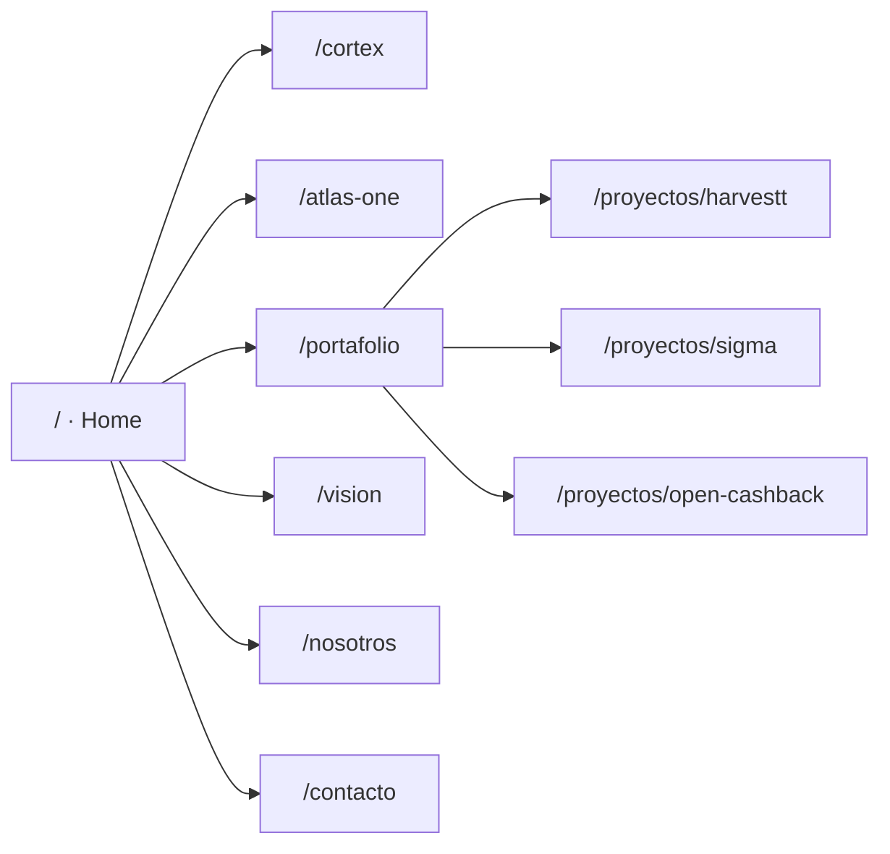

<div align="center">

# Atlas Tech

**Ingeniería para el futuro de las organizaciones.**

Sitio corporativo de Atlas Tech · [atlastech.mx](https://atlastech.mx)

`v4.1` · React 19 + TypeScript · 111 pruebas · Identidad Atlas Horizon

</div>

---

Atlas Tech construye **sistemas agénticos** que resuelven problemas reales hoy y, con eso, financia la
investigación de cómo operarán las organizaciones de mañana. El sitio cuenta esa historia con una regla:
**cada capacidad dice en qué etapa está** y cada cifra lleva su fuente. Toda la conversión lleva a una
sola acción: *Agenda una llamada*.

## Contenido

1. [Productos](#1-productos)
2. [Mapa del sitio](#2-mapa-del-sitio)
3. [Reglas de contenido](#3-reglas-de-contenido)
4. [Identidad: Atlas Horizon](#4-identidad-atlas-horizon)
5. [Arquitectura](#5-arquitectura)
6. [Desarrollo](#6-desarrollo)
7. [Compilación y despliegue](#7-compilación-y-despliegue)
8. [Documentación](#8-documentación)
9. [Historial](#9-historial)

---

## 1. Productos

| Producto | Qué es | Estado | Página |
|---|---|---|---|
| **Atlas Cortex** | Consultoría como servicio, ligada al software. Nuestro equipo y nuestros agentes diagnostican, planean y llevan a ejecución con evidencia. | `MVP` | `/cortex` |
| **Atlas ONE** | Suite para operar negocios físicos: punto de venta, caja, inventario y clientes. | `Validado` | `/atlas-one` |
| **Atlas Core** | El núcleo de Atlas ONE. Cada otro software de Atlas es un módulo sobre él: Financials (`MVP`), Booking (`MVP`), Print Agent (`Validado`). | por módulo | `/atlas-one` |
| **Atlas Solutions** | Ingeniería a la medida, integración y consultoría para empresas. | `Validado` | `/portafolio#solutions` |
| **Atlas Labs** | Unidad de investigación aplicada, en formación. | `Investigación` | `/vision` |
| Portafolio | Harvestt (inteligencia ciberfísica), SIGMA (gobierno digital), Open Cashback (lealtad programable). | por proyecto | `/portafolio` |

Las cuatro familias de lo que construimos, tal como aparecen en el Home:

| Familia | Estado |
|---|---|
| Sistemas agénticos | `Validado` |
| Software autónomo | `En desarrollo` |
| Software autoevolutivo | `Investigación` |
| Sistemas operativos cognitivos | `MVP` |

> **Moonshot.** Investigamos las organizaciones sintéticas: personas, agentes, sistemas digitales y recursos
> físicos coordinados como una organización capaz de aprender y evolucionar, con propósito y responsabilidad
> humanos. Es una apuesta de investigación, no una promesa de disponibilidad.

---

## 2. Mapa del sitio



| Ruta | Contenido |
|---|---|
| `/` | Portada, hero comercial, cómo funciona, moonshot y cifras, las cuatro familias, Atlas ONE, Atlas Solutions, clientes, portafolio |
| `/cortex` | Qué funciona hoy, qué está en construcción y qué es visión; alcance del MVP con criterio de salida; agentes; autonomía progresiva; gobierno |
| `/atlas-one` | Cifras con fuente, demo interactivo, módulos, Atlas Core, giros y precio |
| `/portafolio` | Harvestt, SIGMA y Open Cashback; Atlas Solutions con cifras, metodología, casos y modelos de trabajo |
| `/vision` | La tesis de largo plazo: siete capas del software, declaración en cuatro tiempos, manifiesto, organización sintética, gobernanza, tres horizontes, hoja de ruta 2026–2040 y Atlas Labs |
| `/nosotros` | La startup, el moonshot y los reconocimientos |
| `/contacto` | Agenda una llamada por WhatsApp o correo, sin backend |
| `/proyectos/…` | Detalle de Harvestt, SIGMA y Open Cashback, con estética propia |

Direcciones anteriores, redirigidas con 301 en el router y en `.htaccess`:

| Antes | Ahora |
|---|---|
| `/home` | `/` |
| `/about` | `/nosotros` |
| `/contact` | `/contacto` |
| `/service`, `/service-details` | `/cortex` |
| `/proyectos` | `/portafolio` |
| `/proyectos/atlas-one` | `/atlas-one` |

---

## 3. Reglas de contenido

1. **Nada de hoja de ruta presentada como hecho.** Todo producto o capacidad lleva una etiqueta de estado:
   `Validado` · `MVP` · `En desarrollo` · `Concepto` · `Investigación`.
2. **Ninguna cifra sin fuente y periodo**, en un pie visible junto a la cifra.
3. **Todo en español**, salvo nombres de producto.
4. **Clientes:** solo los logos ya publicados.
5. **Sin backend:** el formulario arma el mensaje y abre WhatsApp; no guarda datos.
6. **No se publican** nombres internos sin validar (Project Genesis, SOMM, OCGR, VAO).

### Cifras publicadas

| Cifra | Dónde | Fuente y periodo |
|---|---|---|
| $80.1M MXN en ventas registradas | Home, Atlas ONE | Datos de operación de Atlas ONE · 90 días · corte 09.09.2026 |
| 134,844 tickets procesados | Home, Atlas ONE | Mismo periodo y corte |
| $593.93 de ticket promedio | Home, Atlas ONE | Mismo periodo y corte |
| $350M MXN procesados | Atlas ONE | Datos de operación de Atlas ONE · 2026 |
| 13 sucursales activas | Atlas ONE | Datos de operación de Atlas ONE · 2026 |
| 7 clientes enterprise · 25 integraciones · 100+ usuarios · MVP en 2 semanas | Home, Portafolio | Atlas Tech, datos internos · 2026 |
| 13 reconocimientos internacionales | Home, Nosotros | 2016–2021 |

El contenido vive como datos tipados en `atlasws/src/site/content/` y lo protege `content.test.ts`: las
pruebas fallan ante una cifra sin fuente, un término prohibido, un mensaje en inglés o un estado distinto
al acordado.

### Contacto público

El sitio usa **`hola@atlastech.mx`** y WhatsApp **+52 722 149 5215**. Es una decisión de los fundadores: el
contacto del brochure institucional no se usa en la web. Se define en `atlasws/src/site/lib/whatsapp.ts`.

---

## 4. Identidad: Atlas Horizon

Negro cinematográfico, luz cálida y tipografía ligera. La idea central es **luz en el horizonte**: la
tecnología de frontera vista como el borde iluminado de algo que apenas empieza. La marca tiene dos
colores: **ember** (cálido, principal) e **índigo** (frío, su contraluz).

| Token | Valor | Uso |
|---|---|---|
| `--bg` | `#050505` | Fondo |
| `--ink` | `#F5F2EE` | Texto principal, blanco cálido |
| `--muted` | `#A8A29A` | Bajadas y cuerpo secundario |
| `--dim` | `#8A837B` | Etiquetas, pies y metadatos (contraste 5.4:1) |
| `--dim-line` | `#6E6862` | Solo líneas y detalles; no se usa en texto |
| `--accent` (ember) | `#FF6A1F` | Una palabra o frase clave por vista y la card destacada |
| `--amber` / `--glow` | `#FFA14A` / `#FFD3A8` | Luz media y etiqueta `MVP` / núcleo de la luz |
| `--indigo` / `--lavanda` | `#5B58B8` / `#9AA6E0` | Contraluz frío; nunca le gana al ember |
| `--signal` | `#9FE0C0` | Solo la etiqueta `Validado` |
| `--glass` / `--rule` | blanco al 4.5% / 14% | Cards de vidrio / reglas y divisores |

- **Tipografía.** Inter en peso 300 para titulares, cifras y cuerpo grande; 400–500 para botones y nombres.
  Nunca 700. JetBrains Mono solo para folios, etiquetas de estado y datos técnicos.
- **Luz.** Una composición por vista, siempre detrás del contenido. El **horizonte** es el motivo de la
  marca y cierra el Home; el **haz** acompaña las cifras; el **resplandor** va en una esquina. El contraluz
  índigo forma parte de la misma composición. Salvo la portada, toda la luz es CSS.
- **Formas.** Botones y navegación en píldora, cards de vidrio con radio de 22 px, una sola card ember por
  vista y grano de película sobre toda la página.
- **Lockup.** Marca + `Atlas` (500) + segundo nombre (300, atenuado). Solo el producto protagonista de la
  página va en ember.

Los tokens están en `atlasws/src/site/tokens.css` y la luz en `components/Atmosphere.tsx`, bajo la clase
raíz `.noir` (nombre histórico). `brand.test.ts` falla si reaparece un acento de marcas anteriores o un
peso tipográfico grueso.

---

## 5. Arquitectura

| Capa | Tecnología |
|---|---|
| UI | React 19 + TypeScript |
| Rutas | React Router 7 |
| Build | Create React App (react-scripts 5) |
| Estilos | CSS propio con tokens; Bootstrap solo en las páginas de detalle del portafolio |
| Scroll | Lenis, apagado con "reducir movimiento" |
| SEO | Metadatos por ruta, inyector estático en el build, JSON-LD y sitemap |
| Pruebas | Jest + React Testing Library · 13 suites, 111 pruebas |
| Hosting | Hostinger (Apache) |

```
atlas_tech_website/
├── atlasws/                         Aplicación React
│   ├── public/
│   │   ├── .htaccess                Redirecciones 301, SPA, HTTPS, caché y seguridad
│   │   └── images/                  Portada del Home, vista previa al compartir
│   ├── scripts/                     seo-build, gen-favicons, optimize-images
│   └── src/
│       ├── site/                    El sitio (identidad Atlas Horizon)
│       │   ├── tokens.css           Tokens y base de la marca
│       │   ├── content/             Textos y datos tipados, con pruebas de honestidad
│       │   │                        home · cortex · atlasOne · solutions · vision · nosotros
│       │   ├── components/          Header, footer, luz, botones, etiquetas, formulario, SolutionsBlock
│       │   ├── pages/               Home, Cortex, Atlas ONE, Portafolio, Visión, Nosotros, Contacto
│       │   └── lib/whatsapp.ts      Contacto público y mensajes
│       ├── main-component/          Rutas, arranque y páginas de detalle del portafolio
│       ├── components/AtlasOneDemos Demo interactivo de Atlas ONE
│       ├── data/projects.ts         Datos del portafolio
│       └── seo/                     seo.config.json (fuente única) y resolución por ruta
├── contex/                          Informes de estado, briefs y referencias (no se compila)
├── docs/
│   ├── index.html                   Visor local de la documentación
│   └── superpowers/                 Diseños aprobados y plan de implementación
└── README.md
```

**Para cambiar un texto o una cifra** se edita el archivo correspondiente en `src/site/content/`; las
páginas solo lo presentan. Si el cambio rompe una regla de contenido, la prueba lo dice.

---

## 6. Desarrollo

Requisito: Node.js 18 o superior.

```bash
cd atlasws
npm ci
npm start                                        # http://localhost:3000
CI=true npx react-scripts test --watchAll=false  # pruebas
```

Para leer la documentación con formato, desde la raíz del repositorio:

```bash
python3 -m http.server 4100                      # http://localhost:4100/docs/
```

En WSL con el repositorio en `/mnt/c` la recarga en caliente no funciona: hay que reiniciar `npm start`
o compilar y servir `build/`.

---

## 7. Compilación y despliegue

```bash
cd atlasws
CI=false npm run build    # el postbuild inyecta SEO por ruta, sitemap y robots
```

1. En hPanel, abrir el administrador de archivos en `public_html`.
2. Subir **todo el contenido de `atlasws/build/`**, incluido el `.htaccess` oculto.
3. Confirmar que el SSL está activo para `atlastech.mx`.
4. Verificar con `curl -I` las direcciones anteriores y las nuevas, y reenviar `sitemap.xml` a Google
   Search Console.

Para cambiar el dominio se edita `siteUrl` en `atlasws/src/seo/seo.config.json` y se vuelve a compilar.

---

## 8. Documentación

| Documento | Contenido |
|---|---|
| [`contex/INFORME-estado-2026-11.md`](contex/INFORME-estado-2026-11.md) | Estado vigente, decisiones y pendientes |
| [`docs/superpowers/specs/2026-11-25-vision-y-arquitectura-de-producto-design.md`](docs/superpowers/specs/2026-11-25-vision-y-arquitectura-de-producto-design.md) | Visión, mapa de productos y afinación con el brochure 2026 |
| [`docs/superpowers/specs/2026-11-17-reestructura-sitio-cortex-design.md`](docs/superpowers/specs/2026-11-17-reestructura-sitio-cortex-design.md) | Diseño de la reestructura con Cortex al frente |
| [`docs/superpowers/plans/2026-11-17-reestructura-sitio-cortex.md`](docs/superpowers/plans/2026-11-17-reestructura-sitio-cortex.md) | Plan de implementación de la reestructura |
| [`contex/README.md`](contex/README.md) | Índice de briefs y referencias |

---

## 9. Historial

| Versión | Fecha | Cambio |
|---|---|---|
| **v4.1** | 2026-11 | Visión y arquitectura de producto. Página `/vision`, Atlas Core, Atlas Solutions, cuatro familias con estado, alcance del MVP de Cortex, gobernanza y cifras anuales. Contraluz índigo y mejor contraste en textos tenues. |
| **v4.0** | 2026-11 | Cortex al frente e identidad Atlas Horizon. Seis páginas nuevas, rutas en español con redirecciones 301, etiquetas de estado y cifras con fuente. Se retiran 305 archivos y 17 dependencias de la plantilla. |
| **v3.0** | 2026-06 | Portafolio con datos tipados, páginas de SIGMA, Open Cashback y Harvestt, SEO por ruta e imágenes WebP. |
| **v2.0** | 2026-04 | Renovación visual (retirada en v4.0). |
| **v1.0** | — | Configuración inicial. |

---

<div align="center">

Atlas Tech · Tecnología de frontera · Ciudad de México · Desde 2016

© 2026 Atlas Tech

</div>
