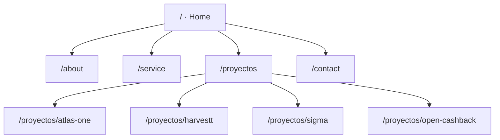

> [!abstract] Resumen
> Sitio corporativo de **Atlas Tech** (venture studio e ingeniería de software, LATAM).
> React 19 + TypeScript (Create React App). Incluye un **portafolio data-driven** con 4 productos
> (Atlas One, Harvestt, SIGMA, Open Cashback), **SEO por ruta** con inyección estática, diseño
> **responsivo** reforzado, imágenes optimizadas a **WebP**, y branding/contacto reales.
> **Listo para desplegar** en Hostinger → `atlastech.mx`.

---

## 🧭 Mapa del sitio



---

## 🧱 Stack técnico

| Capa | Tecnología |
|---|---|
| UI | React 19 + TypeScript |
| Routing | React Router DOM 7 |
| Build | Create React App (react-scripts 5) |
| 3D / animación | Three.js, GSAP, WOW.js |
| Estilos | CSS + Bootstrap 5 |
| SEO | Meta por ruta + inyector estático + JSON-LD + sitemap |
| Imágenes | WebP vía `sharp` |
| Hosting | Hostinger (Apache) — **atlastech.mx** |

---

## 🗂️ Productos / Portafolio

> [!info] Data-driven
> Todo sale de `src/data/projects.ts`. `/proyectos` lista automáticamente; cada slug tiene
> página de detalle (genérica o custom).

| Producto | Ruta | Categoría | Estética |
|---|---|---|---|
| [[Atlas One]] | `/proyectos/atlas-one` | SaaS · POS · ERP | Detalle + demo interactivo |
| [[Harvestt]] | `/proyectos/harvestt` | AgroTech · IA (premiado) | SpaceX — negro, fotografía |
| [[SIGMA]] | `/proyectos/sigma` | GovTech · Sector Público | Institucional — navy + azul acero |
| [[Open Cashback]] | `/proyectos/open-cashback` | Blockchain · Fintech | Web3 — neón violeta + cyan |

---

## 🔍 SEO

> [!success] Implementado
> - **Fuente única:** `src/seo/seo.config.json` (meta + JSON-LD por ruta). Cambiar dominio = 1 línea.
> - **Runtime:** `SeoRouter.tsx` (sin dependencias, React 19) actualiza title/OG/Twitter/canonical/JSON-LD.
> - **Build:** `scripts/seo-build.cjs` (postbuild) genera **HTML por ruta** + `sitemap.xml` + `robots.txt`.
> - **.htaccess** Apache: SPA, HTTPS, www→no-www, cache, compresión, seguridad.

---

## 📱 Responsividad & ⚡ Rendimiento

- `src/css/responsive.css` → clase `.r-stack` colapsa grids de 2→1 columna (<860px).
- Rejillas auto-fit blindadas con `minmax(min(Npx, 100%), 1fr)` (sin scroll horizontal).
- `FitStage` auto-escala el demo de Atlas One.
- **WebP** (`scripts/optimize-images.cjs`): imágenes de Harvestt y del template **−90/96%**.

---

## 📞 Contacto & Redes

| Canal | Valor |
|---|---|
| Email | hola@atlastech.mx |
| WhatsApp | **+52 722 149 5215** → `wa.me/527221495215` |
| Instagram | [instagram.com/atlas_tech.mx](https://www.instagram.com/atlas_tech.mx/) |
| Facebook | [enlace](https://www.facebook.com/share/1MBcRaVy8t/?mibextid=wwXIfr) |

> [!warning] Pendiente
> Twitter y LinkedIn del footer aún apuntan a URLs genéricas — falta el enlace real (o quitarlos).

---

## 🎨 Marca

- **Favicon / iconos PWA**: regenerados como el hexágono Atlas (antes eran el logo de React).
  Set: `favicon.svg`, `favicon-16/32.png`, `apple-touch-icon.png`, `logo192/512.png`. Script: `gen-favicons.cjs`.
- **Logo del header**: `logo_atlas.png` (la "A" circular), desktop y móvil.
- **Logos de clientes** (carrusel, SVG blancos): BJX Motors · Syner Group · OftaVisión · DASIC ·
  Smart Site · R MAZH · UNAM · IPN · CIC (IPN).

---

## 🚀 Despliegue (Hostinger)

```bash
cd atlasws
npm run optimize-images   # (opcional) re-optimizar imágenes
CI=false npm run build     # postbuild inyecta SEO + sitemap + robots
# Subir TODO el contenido de atlasws/build/ a public_html (incluye .htaccess oculto)
```

> [!todo] Checklist post-deploy
> - [ ] SSL activo para `atlastech.mx`
> - [ ] Abrir subruta directa (`/proyectos/sigma`) sin 404
> - [ ] Validar Open Graph en [Facebook Debugger](https://developers.facebook.com/tools/debug/)
> - [ ] Enviar `sitemap.xml` a Google Search Console

---

## 🧩 Pendientes / Próximos pasos

> [!todo] Backlog
> - [ ] Enlaces reales de Twitter / LinkedIn (o eliminarlos)
> - [ ] Imágenes Open Graph dedicadas 1200×630 por proyecto
> - [ ] Borrar imágenes originales sin uso en `public/images/projects/harvestt/` (~10 MB)
> - [ ] (Opcional) eliminar páginas legacy `ProjectPage` / `ProjectDetails` (código muerto, sin ruta)
> - [ ] Copys finales y revisión de contenido por proyecto

---

## 📜 Historial de commits (sesión)

| Commit | Descripción |
|---|---|
| `0faa3a7` | Logo Atlas en header; reemplaza rutas legacy `/project` por `/proyectos` |
| `6c8931f` | Redes sociales, WhatsApp, favicon Atlas, logos de clientes, CTA "Contáctanos" |
| `766cde2` | Portafolio (SIGMA, Open Cashback), SEO por ruta, responsividad y WebP |

---

## 🔗 Referencias

- Repo: [github.com/Ecamposg95/atlas_tech_website](https://github.com/Ecamposg95/atlas_tech_website)
- Briefs en `contex/`: [[sigma]] · `open_cashback_master_brief.md` · `harvestt_fotos_prompt_maestro.mb`
- Notas relacionadas: [[Atlas Tech]] · [[SIGMA]] · [[Open Cashback]] · [[Harvestt]] · [[Atlas One]]
