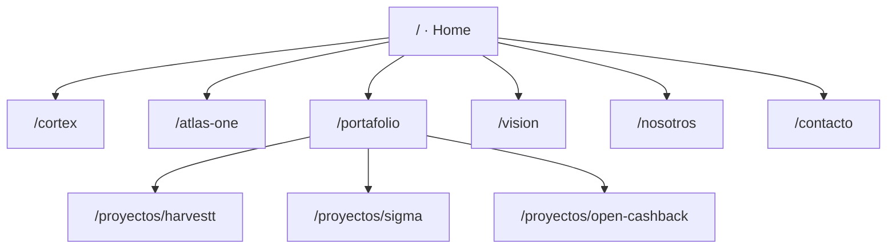

> [!abstract] Resumen
> El sitio dejó de presentarse como "venture studio de IA + blockchain". Ahora cuenta una sola
> historia: **Atlas Tech es una startup que construye sistemas agénticos, ontologías de
> conocimiento e integra tecnologías de frontera**. El producto principal es **Atlas Cortex**,
> posicionado como *Consulting as a Service*; **Atlas ONE** es la base operativa en producción;
> Harvestt, SIGMA y Open Cashback quedan como portafolio. Toda la conversión lleva a
> **"Agenda una llamada"**.
>
>
> **Actualización del 26.11.2026 (v4.1).** Se integraron el documento fundacional y el brochure
> institucional "The Road to Synthetic Organizations": página `/vision`, Atlas Core, Atlas Solutions,
> cuatro familias de producto con estado, alcance del MVP de Cortex, gobernanza y cifras anuales.
> El hero del Home sigue comercial; la tesis de largo plazo vive en `/vision`, en español.
>
> Diseño de la visión: `docs/superpowers/specs/2026-11-25-vision-y-arquitectura-de-producto-design.md`
> Diseño de la reestructura: `docs/superpowers/specs/2026-11-17-reestructura-sitio-cortex-design.md`
> Plan: `docs/superpowers/plans/2026-11-17-reestructura-sitio-cortex.md`

---

## Mapa del sitio



### Estructura del Home

| # | Sección | Contenido |
|---|---|---|
| 0 | Portada | Imagen de marca a pantalla completa ("Atlas Tech. Tecnología de frontera, aplicada.") |
| 1 | Hero | "Consultoría que no entrega un PDF. Entrega ejecución." + botón *Agenda una llamada* |
| 2 | Cómo funciona | Diagnóstico → Plan → Ejecución → Evidencia |
| 3 | Moonshot y cifras | "De agentes a organizaciones sintéticas", con enlace a `/vision`; cuatro cifras con fuente |
| 4 | Qué construimos | Cuatro familias con estado: sistemas agénticos (card ember), software autónomo, software autoevolutivo y sistemas operativos cognitivos |
| 5 | Atlas ONE | Base operativa en producción; prueba de 1 mes gratis |
| 6 | Atlas Solutions | Ingeniería a la medida: cuatro cifras con fuente y enlace a la metodología |
| 7 | Clientes | Nueve logos ya publicados |
| 8 | Portafolio | Harvestt, SIGMA, Open Cashback |
| 9 | Cierre | *Agenda una llamada* sobre el horizonte de luz |

### Páginas añadidas o ampliadas en v4.1

| Página | Qué cambió |
|---|---|
| `/vision` (nueva) | Siete capas del software, declaración en cuatro tiempos, manifiesto, organización sintética y sus principios, lo que no buscamos, gobernanza (niveles N1–N4 y controles base), tres horizontes, hoja de ruta 2026–2040 como escenarios y Atlas Labs con método y primer experimento por línea |
| `/cortex` | Alcance del MVP con criterio de salida por capacidad y lo que queda fuera del MVP |
| `/atlas-one` | Sección Atlas Core (el núcleo y sus módulos) y cifras anuales |
| `/portafolio` | Atlas Solutions: cifras, metodología en cinco pasos, casos frecuentes y modelos de trabajo |

Redirecciones 301 (router + `.htaccess`): `/home`→`/`, `/about`→`/nosotros`, `/contact`→`/contacto`,
`/service` y `/service-details`→`/cortex`, `/proyectos`→`/portafolio`, `/proyectos/atlas-one`→`/atlas-one`.

---

## Identidad: Atlas Horizon

> [!info] Tres iteraciones de marca el mismo día
> El diseño se aprobó como "NOIR con chispa lima"; pasó por Atlas Noir (azul hielo) y terminó en
> **Atlas Horizon**, la guía vigente: negro cinematográfico, luz ámbar y tipografía ligera.

| Elemento | Valor |
|---|---|
| Fondo | `#050505` |
| Texto | `#F5F2EE` (blanco cálido) · secundario `#A8A29A` · tenue `#8A837B` (`#6E6862` queda solo para líneas) |
| Acento | ember `#FF6A1F`, una palabra o frase clave por vista |
| Luz | ámbar `#FFA14A`, núcleo `#FFD3A8`, sombra cálida `#7A240A`, toque frío `#C9DBEA` al final del haz |
| Índigo | `#5B58B8` y lavanda `#9AA6E0`: contraluz frío en el horizonte y los cierres, nunca le gana al ember |
| Señal | `#9FE0C0`, solo para la etiqueta `Validado` |
| Tipografía | Inter 300 en titulares y cifras; 400–500 en botones. Nunca 700. JetBrains Mono solo en folios y etiquetas |
| Formas | Botones y navbar en píldora, cards de vidrio (radio 22px), una card ember destacada, grano de película |
| Motivo | **Horizonte**: arco de luz con el logo sobre la línea (hero del Home). Haz en cifras y cierres; resplandor en páginas de contenido |
| Lockup | `Atlas Tech`; el producto protagonista en ember (`Atlas Cortex`) |

El Home abre con una **portada**: la imagen "Atlas Tech on the Ember Horizon" a pantalla completa
(`public/images/hero/`, WebP), antes del titular de Cortex. El horizonte en CSS pasó al cierre del Home.
El resto de la luz es CSS (`src/site/components/Atmosphere.tsx`), sin WebGL. Lo nuevo vive en
`atlasws/src/site/` bajo la clase `.noir` (nombre histórico). Las páginas de detalle del portafolio
conservan su estética y solo comparten header y footer. `src/site/brand.test.ts` hace cumplir la paleta
y los pesos tipográficos.

Las cifras de Atlas ONE aparecen también en el Home, bajo el moonshot, cada una con la leyenda
"en Atlas ONE" y su pie de fuente, para que no se lean como tracción de Cortex.

---

## Honestidad del contenido

- Cada producto y capacidad lleva etiqueta de estado: Atlas ONE `Validado`, Atlas Cortex `MVP`,
  Atlas Solutions `Validado`, sistemas agénticos `Validado`, Atlas ONE AI `En desarrollo`,
  Atlas Labs y el moonshot `Investigación`, roadmap de Cortex como `Concepto` / `Investigación`.
- Atlas Core es el núcleo de Atlas ONE; sus módulos: Financials `MVP`, Booking `MVP`, Print Agent `Validado`.
- La hoja de ruta 2026–2040 se presenta como escenarios de planificación, no como predicciones.
- No se publican Project Genesis, SOMM, OCGR ni VAO hasta validarlos. Los mensajes del documento
  fundacional van traducidos al español.
- En `/cortex` los ocho agentes por función se presentan como "el equipo que estamos construyendo".
- Cifras publicadas (con fuente, periodo y corte): $80.1M MXN, 134,844 tickets, $593.93
  (Atlas ONE, 90 días, corte 09.09.2026) y 13 reconocimientos internacionales (2016–2021).
- Cifras añadidas en v4.1, autorizadas por la guía de marca y publicadas en el brochure, con fuente y
  periodo 2026: $350M MXN procesados y 13 sucursales activas (Atlas ONE); 7 clientes enterprise,
  25 integraciones activas, 100+ usuarios directos y MVP en 2 semanas (Atlas Solutions).
- Pruebas automáticas (`src/site/content/content.test.ts`) fallan si aparece una cifra sin fuente,
  un cliente no autorizado, un término prohibido o un mensaje en inglés.

---

## Conversión

Sin backend. "Agenda una llamada" → `/contacto` → WhatsApp (`wa.me/527221495215`) con mensaje
prellenado; el formulario arma el mensaje y abre WhatsApp, con `mailto:` como alternativa.
"Pruébalo 1 mes gratis" (Atlas ONE) → WhatsApp con otro mensaje + enlace a `atlasone.com.mx`.

**Contacto público, decidido el 26.11.2026:** el sitio conserva `hola@atlastech.mx` y WhatsApp
`722 149 5215`. El contacto del brochure y de la guía de marca no se usa en la web.

---

## Enlaces a repos y productos

| Producto | Enlace en el sitio | Motivo |
|---|---|---|
| Atlas ONE | `atlasone.com.mx` | El repo **no** se enlaza (ver pendientes de seguridad) |
| Atlas Cortex | ninguno | Repo privado |
| Harvestt | plataforma en vivo + repo público | README presentable |

---

## Stack tras la limpieza

React 19 + TypeScript (CRA), React Router 7, Lenis, Bootstrap (solo para las páginas de detalle).
Se retiraron 17 dependencias sin uso (three, gsap, MUI, swiper, slick, wowjs, entre otras) y
305 archivos de la plantilla. 111 pruebas automáticas. Imagen de vista previa (`/images/og-atlas.png`)
y favicon propios de la identidad Atlas Horizon.

---

## Verificación

- **Pruebas:** 111 automáticas en verde (`CI=true npx react-scripts test --watchAll=false`).
- **Compilación:** `CI=false npm run build` sin errores; genera HTML por ruta, `sitemap.xml` (9 URLs) y `robots.txt`.
- **Visual:** capturas en 360, 768 y 1440 px de las seis páginas, un detalle de portafolio y la página
  de error, sin desbordes ni errores de consola. La portada se revisó en 360 y 1440 px.
- **Revisión independiente** del código antes del cambio de marca: sin hallazgos críticos; los
  importantes se corrigieron y los menores están listados abajo.
- **Sin verificar:** las redirecciones 301 contra el Apache real de Hostinger.

---

## Pendientes del dueño

> [!warning] Seguridad (fuera de este repo)
> El repo público `atlas-one` expone en su README credenciales por defecto del superadministrador,
> la clave por defecto de firma de sesiones y datos de un cliente. Recomendación: hacerlo privado
> y rotar esas credenciales.

> [!todo] Contenido
> - [ ] Fecha de corte exacta de las cifras anuales y de Atlas Solutions (hoy llevan fuente y periodo 2026).
> - [ ] Confirmar los estados de Financials, Booking y Print Agent (tomados de los repos).
> - [ ] Actualizar la guía de marca (sección 11): Atlas Core como núcleo de Atlas ONE, Atlas Solutions,
>       Harvestt y el lema en español.
> - [ ] Verificar los premios de Harvestt contra los diplomas: el repo registra INTARG 2017 (plata)
>       e ICAN Toronto 2018 (oro); la página de detalle lista 2018, 2019 y 2021.
> - [ ] Cambiar la descripción del repo `harvestt` en GitHub ("2016 awr wina toronto").
> - [ ] Confirmar dos textos: "Nuestro primer cliente de Cortex somos nosotros mismos" (viene del documento de visión de Cortex) y "Desde 2016" (viene de la guía de marca).
> - [ ] Calendario en línea (Cal.com / Calendly) si se quiere agenda directa.
> - [x] Contacto: resuelto. La web conserva `hola@atlastech.mx` y WhatsApp `722 149 5215`.
> - [ ] La guía pide todo en español salvo nombres de producto y propone "Agenda un diagnóstico" como
>       llamada a la acción; el sitio usa "Consulting as a Service" y "Agenda una llamada" (decisiones
>       del dueño). Confirmar que se mantienen.
> - [ ] Portada: el nombre y el lema van dentro de la imagen (no son texto real). Si se quiere texto
>       seleccionable y que se adapte mejor al móvil, hace falta la misma imagen **sin texto**.
> - [ ] Las cinco imágenes originales en `contex/` (7 MB en PNG) no están en git; decidir si se suben.

> [!note] Mejoras menores detectadas en la revisión final (no aplicadas)
> - URLs inexistentes responden 200 con la página de error (falta marcarla `noindex`).
> - Las páginas de detalle del portafolio aún enlazan `/contact` y `/proyectos` (funcionan por redirección).
> - Abrir directo `/cortex#estado` o `/atlas-one#demo` no baja a la sección.
> - Menú móvil: sin cierre con Escape; orden de tabulación mejorable. Formulario: sin `aria-invalid`.
> - Con "reducir movimiento", el scroll al cambiar de página sigue siendo suave.
> - Notas de fuente y etiquetas de estado son pequeñas en móvil (≈10 px).
> - Sobras: `@types/react-slick`, lista de imágenes borradas en `optimize-images.cjs`.

> [!todo] Despliegue (Hostinger)
> ```bash
> cd atlasws
> CI=false npm run build      # postbuild inyecta SEO + sitemap + robots
> # Subir TODO build/ a public_html (incluye .htaccess con las redirecciones 301)
> ```
> - [ ] Probar en producción con `curl -I` las 7 direcciones viejas y las 6 nuevas. Las redirecciones solo se
>       verificaron por prueba de contenido, no contra Apache real. Punto a vigilar: el build crea una carpeta
>       por ruta, así que Apache puede redirigir `/cortex` → `/cortex/` (un salto extra frente a la URL canónica).
> - [ ] Reenviar `sitemap.xml` a Google Search Console.

---

## Historial de commits

| Commit | Descripción |
|---|---|
| `770919d` | docs: diseño y plan de la reestructura del sitio (Cortex al frente) |
| `3ae392d` | feat(site): cimientos NOIR — tokens, estado, botones y WhatsApp |
| `47c7e2e` | feat(site): contenido tipado de Cortex, Atlas ONE, Home y Nosotros con pruebas de honestidad |
| `1cdcdbf` | feat(site): header, footer, layout y motivo de órbitas |
| `f27560d` | feat(site): nuevo Home con Cortex al frente |
| `9c2e8ff` | feat(site): página de Atlas Cortex |
| `5f88f8a` | feat(site): Atlas ONE como producto con página propia |
| `c9f61ba` | feat(site): portafolio, nosotros y contacto con WhatsApp |
| `a2e6043` | feat(site): rutas en español, redirecciones 301 y marco compartido |
| `2452d1f` | feat(seo): metadatos y sitemap del nuevo sitio |
| `18e5779` | chore: limpieza del template e informe de estado 2026-11 |
| `5e39df7` | fix(site): correcciones de la revisión final |
| `e2466cb` | feat(brand): identidad Atlas Noir en todo el sitio |
| `5b30571` | docs: documentación alineada a Atlas Noir y al sitio reestructurado |
| `07ca5d3` | feat(brand): acento verde lima en lugar del azul hielo |
| `e357a59` | feat(brand): identidad Atlas Horizon en el sitio y la documentación |
| `3596109` | feat(home): portada con la imagen de marca antes de la primera sección |
| `03b1aef` | fix(brand): contraste de --dim y contraluz índigo de Atlas Horizon |
| `6b9c9fb` | feat(vision): página /vision, Atlas Core y familias de producto con estado |
| `9e34098` | feat(brochure): capas, gobernanza, alcance del MVP y Atlas Solutions |
