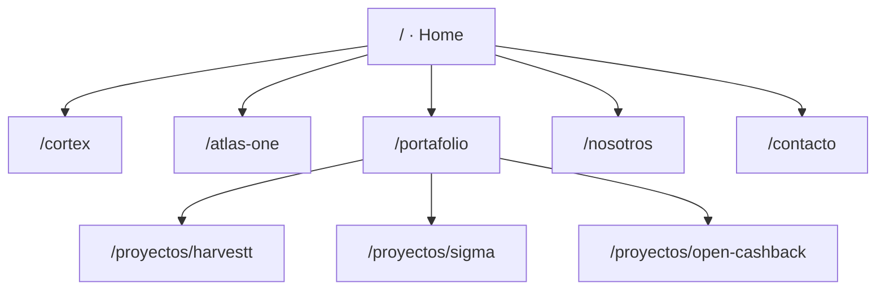

> [!abstract] Resumen
> El sitio dejó de presentarse como "venture studio de IA + blockchain". Ahora cuenta una sola
> historia: **Atlas Tech es una startup que construye sistemas agénticos, ontologías de
> conocimiento e integra tecnologías de frontera**. El producto principal es **Atlas Cortex**,
> posicionado como *Consulting as a Service*; **Atlas ONE** es la base operativa en producción;
> Harvestt, SIGMA y Open Cashback quedan como portafolio. Toda la conversión lleva a
> **"Agenda una llamada"**.
>
> Diseño: `docs/superpowers/specs/2026-11-17-reestructura-sitio-cortex-design.md`
> Plan: `docs/superpowers/plans/2026-11-17-reestructura-sitio-cortex.md`

---

## 🧭 Mapa del sitio



Redirecciones 301 (router + `.htaccess`): `/home`→`/`, `/about`→`/nosotros`, `/contact`→`/contacto`,
`/service` y `/service-details`→`/cortex`, `/proyectos`→`/portafolio`, `/proyectos/atlas-one`→`/atlas-one`.

---

## 🎨 Identidad: Atlas Noir

> [!info] Cambio de marca durante la reestructura
> El diseño se aprobó como "NOIR con chispa lima". El mismo día la guía de marca pasó a **Atlas Noir**
> (azul hielo como único acento; el lima queda fuera) y el sitio se alineó a ella.

| Elemento | Valor |
|---|---|
| Fondo (void) | `#0B0D10` · cards `#13171C` · reglas `#242B33` / `#303741` |
| Texto | `#F4F5F7` · secundario `#A3ADB9` · tenue `#77828F` |
| Acento único | azul hielo `#A9C9EB` (anillo activo y foco `#70A7E0`) |
| Señal | `#8FD9B6`, solo para la etiqueta `Validado` |
| Tipografía | Inter (titulares 700, labels 600 en mayúsculas); JetBrains Mono solo en índices, datos y etiquetas |
| Forma | radio 0, reglas de 1px, sin degradados ni brillo |
| Lockup | `ATLAS / TECH`; en producto `ATLAS / CORTEX`, `ATLAS / ONE` |
| Motivo | órbita: anillos concéntricos, un anillo activo, nodos y el logo al centro (SVG, sin WebGL) |

Todo lo nuevo vive en `atlasws/src/site/` bajo la clase `.noir`. Las páginas de detalle del
portafolio conservan su estética y solo comparten header y footer. `src/site/brand.test.ts`
falla si reaparece un color fuera de la marca.

---

## ✅ Honestidad del contenido

- Cada producto y capacidad lleva etiqueta de estado: Atlas ONE `Validado`, Atlas Cortex `MVP`,
  Atlas ONE AI `En desarrollo`, roadmap de Cortex como `Concepto` / `Investigación`.
- En `/cortex` los ocho agentes por función se presentan como "el equipo que estamos construyendo".
- Cifras publicadas (con fuente, periodo y corte): $80.1M MXN, 134,844 tickets, $593.93
  (Atlas ONE, 90 días, corte 09.09.2026) y 13 reconocimientos internacionales (2016–2021).
- Pruebas automáticas (`src/site/content/content.test.ts`) fallan si aparece una cifra pendiente,
  un cliente no autorizado o un término prohibido.

---

## 📞 Conversión

Sin backend. "Agenda una llamada" → `/contacto` → WhatsApp (`wa.me/527221495215`) con mensaje
prellenado; el formulario arma el mensaje y abre WhatsApp, con `mailto:` como alternativa.
"Pruébalo 1 mes gratis" (Atlas ONE) → WhatsApp con otro mensaje + enlace a `atlasone.com.mx`.

---

## 🔗 Enlaces a repos y productos

| Producto | Enlace en el sitio | Motivo |
|---|---|---|
| Atlas ONE | `atlasone.com.mx` | El repo **no** se enlaza (ver pendientes de seguridad) |
| Atlas Cortex | ninguno | Repo privado |
| Harvestt | plataforma en vivo + repo público | README presentable |

---

## 🧱 Stack tras la limpieza

React 19 + TypeScript (CRA), React Router 7, Lenis, Bootstrap (solo para las páginas de detalle).
Se retiraron 17 dependencias sin uso (three, gsap, MUI, swiper, slick, wowjs, entre otras) y
305 archivos de la plantilla. 95 pruebas automáticas. Imagen de vista previa (`/images/og-atlas.png`)
y favicon propios de la identidad Atlas Noir.

---

## 🧩 Pendientes del dueño

> [!warning] Seguridad (fuera de este repo)
> El repo público `atlas-one` expone en su README credenciales por defecto del superadministrador,
> la clave por defecto de firma de sesiones y datos de un cliente. Recomendación: hacerlo privado
> y rotar esas credenciales.

> [!todo] Contenido
> - [ ] Cifras sin fuente ni corte (no publicadas): 13 sucursales activas · $350M MXN procesados
>       en 2026 · 7 clientes enterprise · 25 integraciones · 100+ usuarios · MVP en 2 semanas.
> - [ ] Verificar los premios de Harvestt contra los diplomas: el repo registra INTARG 2017 (plata)
>       e ICAN Toronto 2018 (oro); la página de detalle lista 2018, 2019 y 2021.
> - [ ] Cambiar la descripción del repo `harvestt` en GitHub ("2016 awr wina toronto").
> - [ ] Confirmar dos textos: "Nuestro primer cliente de Cortex somos nosotros mismos" (viene del documento de visión de Cortex) y "Desde 2016" (viene de la guía de marca).
> - [ ] Calendario en línea (Cal.com / Calendly) si se quiere agenda directa.
> - [ ] Contacto: la guía de marca lista `ecamposg@atlastech.mx` y `722 142 5755`; el sitio conserva
>       `hola@atlastech.mx` y WhatsApp `722 149 5215`. Confirmar cuál debe ir en la web.
> - [ ] La guía pide todo en español salvo nombres de producto; el sitio usa "Consulting as a Service"
>       como nombre de categoría (decisión del dueño). Confirmar que se mantiene.

> [!note] Mejoras menores detectadas en la revisión final (no aplicadas)
> - URLs inexistentes responden 200 con la página de error (falta marcarla `noindex`).
> - Las páginas de detalle del portafolio aún enlazan `/contact` y `/proyectos` (funcionan por redirección).
> - Abrir directo `/cortex#estado` o `/atlas-one#demo` no baja a la sección.
> - Menú móvil: sin cierre con Escape; orden de tabulación mejorable. Formulario: sin `aria-invalid`.
> - Con "reducir movimiento", el scroll al cambiar de página sigue siendo suave.
> - Notas de fuente y etiquetas de estado son pequeñas en móvil (≈10 px).
> - Sobras: `@types/react-slick`, lista de imágenes borradas en `optimize-images.cjs`.

> [!todo] Despliegue (Hostinger)
> ```bash
> cd atlasws
> CI=false npm run build      # postbuild inyecta SEO + sitemap + robots
> # Subir TODO build/ a public_html (incluye .htaccess con las redirecciones 301)
> ```
> - [ ] Probar en producción con `curl -I` las 7 direcciones viejas y las 6 nuevas. Las redirecciones solo se
>       verificaron por prueba de contenido, no contra Apache real. Punto a vigilar: el build crea una carpeta
>       por ruta, así que Apache puede redirigir `/cortex` → `/cortex/` (un salto extra frente a la URL canónica).
> - [ ] Reenviar `sitemap.xml` a Google Search Console.
